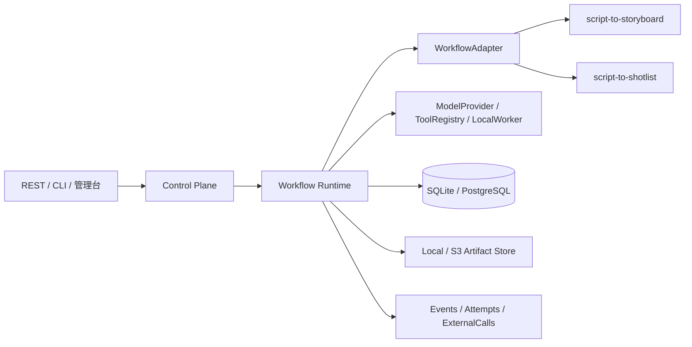

# Agent Workflow Platform

[](https://github.com/jiping730/shortdrama-agent-workbench/actions/workflows/ci.yml)

一个面向个人 Git 作品库的、可恢复且可观测的 Agent Workflow Platform。

它解决的不是“如何聊天”，而是如何把一次 Agent 业务执行变成可追踪、可审核、可恢复的工程流程：

```text
Workflow Definition → Run → Step → Attempt → Artifact → Review → Recovery → Audit
```

当前以 `script-to-storyboard` 作为第一条业务工作流，并用 `script-to-shotlist` 验证平台的扩展边界。平台采用模块化单体设计，优先保证领域模型、运行时状态、持久化和验收闭环，再逐步扩展到更多受控工作流。

## 项目状态

当前版本已完成阶段 0～7 的离线验收，包括：

- 可持久化的 Workflow Runtime、状态转换和事件审计；
- Checkpoint、进程重启恢复、幂等和局部重试；
- 人工审核暂停、场景级拒绝与修订；
- SQLite 本地模式、PostgreSQL 配置模式和 Alembic 首迁移；
- FakeModel 离线演示、REST API、CLI、管理页和 JSON/CSV/HTML 导出；
- `WorkflowAdapter`、`ModelProvider`、`ToolRegistry`、Artifact Store 和本地队列扩展点；
- `script-to-shotlist` 第二条可运行工作流。

真实云对象存储、多 Worker 调度、完整鉴权、多租户、OpenTelemetry exporter 和真实媒体生成仍属于后续范围，详见[已知限制与路线图](#已知限制与路线图)。

## 核心能力

| 能力 | 当前实现 |
| --- | --- |
| 运行时 | Run、StepExecution、Attempt、Checkpoint、状态转换和恢复 |
| 可靠性 | 输入哈希、幂等键、成功结果复用、局部重试、Attempt 历史保留 |
| 审核 | `waiting_review`、ReviewTask、场景级拒绝和修订 |
| 证据 | 稳定 `scene_id`、原文 offset、Evidence 关联和覆盖校验 |
| 模型 | 默认 FakeModel；可选官方 Anthropic SDK Adapter |
| 工具 | 统一注册、Schema、超时、重试、幂等和审计边界 |
| 存储 | SQLite / PostgreSQL；本地 Artifact Store；预留 S3/MinIO 接口 |
| 入口 | FastAPI REST API、CLI、轻量运行管理页 |
| 可观测性 | Run/Step/Attempt 时间线、ToolCall、ModelCall、ExternalCall 和 RunEvent |

## 架构



平台按模块化单体组织，并保留未来拆分边界：

- **Control Plane**：项目、工作流版本、Run、Review、Artifact 查询，以及 REST API、CLI 和管理台。
- **Workflow Runtime**：步骤调度、状态转换、Attempt、Checkpoint、幂等、暂停、恢复和局部重试。
- **Execution Plane**：ModelProvider、ToolRegistry、FakeModel、可选真实模型 Adapter 和 LocalWorker。
- **Data Plane**：SQLAlchemy 领域模型、SQLite/PostgreSQL、Alembic 和 Artifact Store。
- **Observability**：结构化事件、调用记录、时间线和基础运行指标。

## 数据模型

一次运行的主要关系如下：

```text
Workspace / Project
        └── WorkflowDefinition / WorkflowVersion
                └── Run
                    ├── Task / StepExecution
                    │       └── Attempt
                    ├── Checkpoint
                    ├── Artifact ── Evidence
                    ├── ReviewTask
                    ├── ToolCall / ExternalCall
                    └── RunEvent
```

关键设计原则：

- 成功结果和历史 Attempt 不被覆盖；
- 每个安全边界保存 Checkpoint 和工件引用；
- 外部调用超时或连接中断进入 `unknown`，确认前不自动重复；
- 相同工作流版本、步骤、输入哈希和参数不会重复产生成功结果；
- 非法状态转换会抛出领域错误，并写入审计事件。

## 第一条工作流：script-to-storyboard

标准步骤链路为：

```text
prepare_input
  → split_script
  → build_source_index
  → extract_facts
  → validate_facts
  → generate_storyboard
  → validate_storyboard
  → wait_for_human_review
  → revise_rejected_scenes
  → adopt_result
  → export_artifacts
```

业务约束：

- 场景切分优先采用确定性规则，并生成稳定的 `scene_id`；
- 事实和分镜都必须关联原文 Evidence；
- 模型输出必须经过 Pydantic Schema 校验；
- 审核拒绝某个场景时，只创建该场景的新 Attempt；
- 已通过的场景复用既有 Artifact，不重新生成；
- FakeModel 支持 `success`、`invalid_output`、`timeout`、`model_error` 和 `unknown` 五种确定性模式。

## 快速开始

### 本地运行

项目要求 Python 3.9 或更高版本。Windows PowerShell 可执行：

```powershell
py -3.9 -m venv .venv
\.venv\Scripts\Activate.ps1
py -3.9 -m pip install -e ".[dev]"
py -3.9 -m uvicorn agent_platform.api:app --reload
```

macOS/Linux 将 `py -3.9` 替换为 `python3` 即可。

打开 <http://localhost:8000/> 可查看轻量运行管理页。该页面以 Run、步骤时间线、Attempt、证据、审核和工件为中心，不是聊天首页。

### Docker + PostgreSQL

```bash
docker compose up --build
```

服务地址仍为 <http://localhost:8000/>；PostgreSQL 默认映射到本机 `127.0.0.1:5433`。停止服务：

```bash
docker compose down
```

### 第一个离线 Run

使用默认 FakeModel，不需要 API Key：

```bash
python -m agent_platform.cli workflow list
python -m agent_platform.cli --json run create \
  --project-id demo \
  --script-file examples/sample_script.txt
python -m agent_platform.cli --json run list --project-id demo
```

Windows PowerShell 可以使用同一组命令；续行符也可以改成单行执行。

## 审核、局部重试与恢复

Run 完成生成后会停在 `waiting_review`。拒绝一个场景，只修订该场景：

```bash
python -m agent_platform.cli --json review list --run-id RUN_ID
python -m agent_platform.cli --json review reject \
  --review-id REVIEW_ID \
  --reviewer demo \
  --comment "请强化动作"
python -m agent_platform.cli --json run retry \
  --run-id RUN_ID \
  --scene-id SCENE_ID
```

修订完成后，再次查看新 Review 并批准：

```bash
python -m agent_platform.cli --json review list --run-id RUN_ID
python -m agent_platform.cli --json review approve \
  --review-id NEW_REVIEW_ID \
  --reviewer demo
```

进程中断后，Runtime 从最近有效 Checkpoint 继续。已经成功的步骤不会被重复执行；被拒绝的场景保留原 Attempt，并生成新的修订 Attempt。恢复和状态转换的详细约束见 [docs/recovery.md](docs/recovery.md) 和 [docs/state-machine.md](docs/state-machine.md)。

## REST API

启动服务后，主要接口包括：

```text
POST /api/v1/runs
GET  /api/v1/runs
GET  /api/v1/runs/{run_id}
POST /api/v1/runs/{run_id}/pause
POST /api/v1/runs/{run_id}/resume
POST /api/v1/runs/{run_id}/cancel
POST /api/v1/runs/{run_id}/retry
GET  /api/v1/runs/{run_id}/events
GET  /api/v1/runs/{run_id}/artifacts
GET  /api/v1/runs/{run_id}/reviews
POST /api/v1/reviews/{review_id}/approve
POST /api/v1/reviews/{review_id}/reject
```

FastAPI 文档可在 <http://localhost:8000/docs> 查看。

## CLI 与导出

```text
agent-platform run create/show/list/pause/resume/cancel/retry
agent-platform review list/approve/reject
agent-platform workflow list/describe
agent-platform export json/csv/html
```

导出示例：

```bash
python -m agent_platform.cli export json --run-id RUN_ID --output exports/run.json
python -m agent_platform.cli export csv  --run-id RUN_ID --output exports/run.csv
python -m agent_platform.cli export html --run-id RUN_ID --output exports/run.html
```

使用 `--json` 获取稳定的机器可读输出，便于脚本、CI 和其他控制面客户端调用。

## 环境变量与配置

`.env.example` 是脱敏配置模板。项目不会把密钥写入代码或提交到 Git；按需将变量注入本地进程或容器环境。

| 变量 | 默认值 / 说明 |
| --- | --- |
| `DATABASE_URL` | `sqlite:///./agent_platform.db`；PostgreSQL 使用 `postgresql+psycopg://...` |
| `ARTIFACT_DIR` | `./data/artifacts` |
| `FAKE_MODEL_MODE` | `success`；也可设为 `invalid_output`、`timeout`、`model_error`、`unknown` |
| `MODEL_PROVIDER` | `fake`；可选 `anthropic` |
| `ARTIFACT_BACKEND` | `local`；可选 `s3` |
| `S3_ARTIFACT_BUCKET` | S3/MinIO 模式下的 Bucket |
| `S3_ARTIFACT_PREFIX` | 默认 `artifacts` |
| `S3_ENDPOINT_URL` | 可选的 S3/MinIO Endpoint |
| `ANTHROPIC_API_KEY` | 仅在 `MODEL_PROVIDER=anthropic` 时注入，禁止提交真实值 |
| `ANTHROPIC_MODEL` | Anthropic Adapter 使用的模型名 |

### 可选真实模型

```bash
python -m pip install -e ".[anthropic]"
```

显式设置 `MODEL_PROVIDER=anthropic` 后，平台通过官方 Anthropic SDK 调用模型。真实模型结果仍必须经过 Schema 校验，并记录 Attempt、Artifact 和事件审计；项目不使用 OpenAI 兼容接口模拟 Claude。

## 扩展方式

平台通过稳定的接口承载后续工作流和执行能力：

- `WorkflowAdapter`：注册、校验、启动、恢复、执行步骤和恢复处理；
- `ModelProvider`：`generate_facts`、`generate_storyboard`、`revise_storyboard`；
- `ToolRegistry`：工具名、版本、输入/输出 Schema、超时、重试、幂等和审计；
- `ArtifactStore`：本地文件存储和 S3/MinIO 扩展边界；
- `LocalWorker` + `SQLiteTaskQueue`：单机异步执行验证，不改变核心 Runtime 状态机。

扩展新工作流时，应先定义输入/输出 Schema、证据契约、状态边界和验收测试，再接入 Runtime。具体约定见 [docs/extension-guide.md](docs/extension-guide.md)。

## 测试与质量门禁

安装开发依赖：

```bash
python -m pip install -e ".[dev]"
```

运行格式、静态检查和测试：

```bash
python -m ruff check .
python -m ruff format --check .
python -m pytest -q --basetemp=.pytest-tmp
python -m compileall agent_platform tests
```

只运行阶段门禁：

```bash
python -m pytest -q tests/gates
```

当前离线验证结果为 `50 passed, 1 skipped`；跳过项是未配置 `STAGE2_POSTGRES_URL` 时的 PostgreSQL 专项测试。GitHub Actions 会在 Python 3.10 和 3.12 上执行 Ruff、pytest、compileall 和 secret scan。

也可以使用仓库内的 Makefile：

```bash
make install
make test
make run
```

## 文档

完整文档入口：[docs/README.md](docs/README.md)。重要文档包括：

- [reference-analysis.md](docs/reference-analysis.md)：四个参考项目的只读分析和隔离边界；
- [architecture-decisions.md](docs/architecture-decisions.md)：Runtime 解耦、模块化单体和非 RAG 核心决策；
- [capability-matrix.md](docs/capability-matrix.md)：当前已吸收能力、代码证据、未覆盖能力和完善路线；
- [stage-gates.md](docs/stage-gates.md)：阶段 0～7 的验收证据和延期范围；
- [architecture.md](docs/architecture.md)：模块边界与数据流；
- [state-machine.md](docs/state-machine.md)：Run/Step 状态和合法转换；
- [recovery.md](docs/recovery.md)：Checkpoint、恢复、幂等和 `unknown` 安全策略；
- [extension-guide.md](docs/extension-guide.md)：WorkflowAdapter、Provider、Tool 和存储扩展方法；
- [security-scanning.md](docs/security-scanning.md)：脱敏、secret scanning 和 Git 交付检查。

四个参考目录始终只读。新项目不复制公司源码、内部 Prompt、账号、密钥、接口地址或业务数据；已有个人 RAG 项目也不在新项目依赖树中。

## 已知限制与路线图

当前明确限制：

- 核心 API 默认同步执行；
- 本地队列适合单机 Worker，不替代 Redis、SQS 等生产级队列；
- S3/MinIO 适配器提供扩展契约，但尚未进行真实云端数据演练；
- Anthropic Adapter 需要显式安装可选依赖、配置模型和真实凭据；
- 暂未提供完整鉴权、多租户、复杂计费和生产级多 Worker lease；
- 不实现真实视频、图片或音频生成。

后续路线是分别为生产级队列、对象存储、OpenTelemetry、鉴权和更多受控工作流建立独立验收，再决定是否引入分布式部署。向量数据库、Embedding、GraphRAG、Tavily、长期对话记忆和 MCP 不属于本平台核心技术路线。

## 安全与 Git 交付

- `.env`、数据库文件、Artifact、密钥和本地日志均加入 `.gitignore`；
- 提交前可运行 `gitleaks detect --no-banner` 进行敏感信息扫描；
- 不提交 API Key、内部地址、账号、业务原文或本地绝对路径；
- 所有“已支持”能力必须对应代码、测试或可运行演示；延期能力不会作为当前版本承诺。

## License

当前仓库未声明开源许可证。若作为公开作品库发布，建议在确认代码来源和参考项目许可边界后补充明确的 License 文件。
