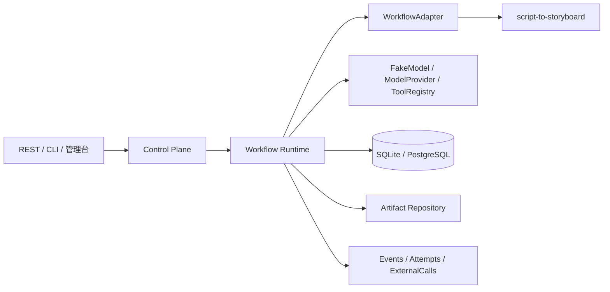

# Agent Workflow Platform

一个面向 Git 个人作品库的模块化单体 Agent Workflow Platform。产品核心不是聊天，而是：

`Workflow Definition → Run → Task/Step → Attempt → Artifact → Review → Recovery → Audit`

第一条工作流是 `script-to-storyboard`；平台保留扩展边界，未来可以接入 shotlist、character-sheet、production-plan 等受控工作流。

## 已实现能力

- SQLite 本地模式和 PostgreSQL URL 模式，SQLAlchemy 领域模型与 Alembic 首迁移。
- Run/Step/Attempt/Checkpoint/Artifact/Evidence/Review/ExternalCall/ToolCall/RunEvent 持久化。
- 显式 Run/Step 状态转换，非法转换记录事件并抛出领域错误。
- 确定性场景切分、稳定 scene ID、原文 source offset 和 Evidence。
- Pydantic 结构化事实/分镜校验；每个事实和每条 Shot 都必须引用 Evidence。
- FakeModel 默认离线运行：`success`、`invalid_output`、`timeout`、`model_error`、`unknown`。
- 审核暂停、逐 scene selective retry、Attempt 保留、成功步骤幂等复用、unknown 禁止盲重试。
- 版本化 REST API、最小 CLI、运行管理页、JSON/CSV/HTML 导出。
- `ModelProvider`、`WorkflowAdapter`、`ToolRegistry`、本地 ArtifactStore 和可选 Anthropic 官方 SDK Adapter。

## 架构



更完整的模块边界见 [docs/architecture.md](docs/architecture.md)，状态表见 [docs/state-machine.md](docs/state-machine.md)，恢复策略见 [docs/recovery.md](docs/recovery.md)。

## 数据模型

核心链路为 `WorkflowDefinition → WorkflowVersion → Run → Task/StepExecution → Attempt → Artifact → ReviewTask → Checkpoint → RunEvent`；Evidence、ToolCall 和 ExternalCall 作为可审计的关联记录持久化。

## 一次运行示例

```bash
python -m agent_platform.cli workflow list
python -m agent_platform.cli --json run create \
  --project-id demo \
  --script-file examples/sample_script.txt
python -m agent_platform.cli --json run list --project-id demo
```

创建后 Run 会停在 `waiting_review`。查看 Review：

```bash
python -m agent_platform.cli --json review list --run-id RUN_ID
python -m agent_platform.cli --json review reject \
  --review-id REVIEW_ID --reviewer demo --comment "请强化动作"
python -m agent_platform.cli --json run retry \
  --run-id RUN_ID --scene-id SCENE_ID
python -m agent_platform.cli --json review list --run-id RUN_ID
python -m agent_platform.cli --json review approve \
  --review-id NEW_REVIEW_ID --reviewer demo
```

审核通过后，Run 进入 `completed`。重复提交相同 project/script 会返回已完成 Run，不新建成功步骤。

## API

服务启动：

```bash
python -m uvicorn agent_platform.api:app --reload
```

主要接口：

`POST /api/v1/runs`、`GET /api/v1/runs`、`GET /api/v1/runs/{run_id}`、`POST /api/v1/runs/{run_id}/pause|resume|cancel|retry`、`GET /api/v1/runs/{run_id}/events|artifacts|reviews`、`POST /api/v1/reviews/{review_id}/approve|reject`。

打开 `http://localhost:8000/` 可看到 Run、步骤时间线和审核入口的轻量管理页；它不是聊天首页。

## 导出

```bash
python -m agent_platform.cli export json --run-id RUN_ID --output exports/run.json
python -m agent_platform.cli export csv  --run-id RUN_ID --output exports/run.csv
python -m agent_platform.cli export html --run-id RUN_ID --output exports/run.html
```

## 测试与 Docker

```bash
python --version  # Python 3.9+
python -m pip install -e ".[dev]"
python -m pytest -q --basetemp=.pytest-tmp
docker compose up --build
```

若本机 Python/Windows 临时目录策略阻止 pytest 创建默认 temp root，项目已把基准目录固定为仓库内 `.pytest-tmp`，也可以显式传入该参数。

## 环境变量与配置

从 [.env.example](.env.example) 开始：

- `DATABASE_URL`：默认 `sqlite:///./agent_platform.db`；PostgreSQL 使用 `postgresql+psycopg://...`，本地可安装 `.[postgres]` 获取 psycopg driver。
- `ARTIFACT_DIR`：本地 Artifact 文件目录。
- `FAKE_MODEL_MODE`：默认 `success`，也可用 `invalid_output`、`timeout`、`model_error`、`unknown` 验证错误流。
- `ANTHROPIC_API_KEY` / `ANTHROPIC_MODEL`：仅用于可选官方 Anthropic SDK Adapter，密钥只从环境注入。

真实模型接入不改变 Runtime：注入实现 `ModelProvider` 的 Adapter，所有结果仍须走 schema 校验、Attempt、Artifact 和事件审计。项目不使用 OpenAI 兼容接口模拟 Claude。

## 参考项目与技术边界

参考分析见 [docs/reference-analysis.md](docs/reference-analysis.md)，决策见 [docs/architecture-decisions.md](docs/architecture-decisions.md)。已有 Agent Workflow 的 Skill 分层、稳定 ID、ReviewGate、模型注入和工具桥接被抽象成 Adapter/Provider/Registry 边界；没有把参考仓库作为依赖，也没有复制内部 Prompt、账号、地址或业务数据。既有个人 RAG 项目不在依赖树中，新平台也不是 RAG 项目：不以向量库、Embedding、GraphRAG、Tavily、长期记忆或 MCP 为核心。

## 已完成、延期和限制

已完成：模块化单体 Runtime、持久化领域表、Checkpoint/恢复、局部审核重试、离线 FakeModel、API/CLI/导出、管理页、Docker/迁移/CI 基础文件和离线测试。

明确延期：真实异步队列、多 worker lease、S3/MinIO 实现、OpenTelemetry exporter、完整鉴权/多租户、复杂计费、真实媒体生成、更多业务工作流。

已知限制：第一版同步执行 worker；默认 SQLite 不适合作为多进程生产库；PostgreSQL driver 需要按部署环境安装；Anthropic adapter 需要显式安装可选依赖并配置模型策略。

## 安全与 Git 交付

- `.env`、数据库、Artifact、密钥文件和本地日志均在 `.gitignore`。
- 不提交 API key、内部地址、账号、业务原文和绝对路径；提交前运行 secret scanner（例如 `gitleaks detect --no-banner`，若本机安装）。
- 本仓库只读取参考目录，不修改参考目录。
