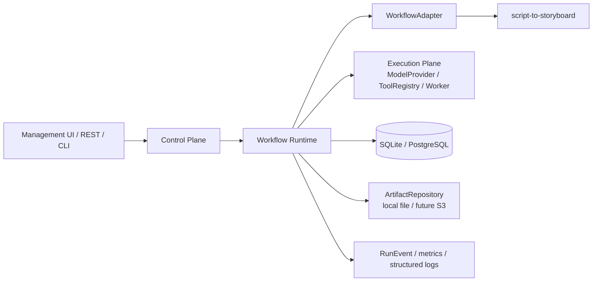

# Architecture

核心生命周期：

`WorkflowDefinition → WorkflowVersion → Run → Task/StepExecution → Attempt → Artifact → ReviewTask → Recovery → RunEvent`

## 模块边界

- Control Plane：Workspace、Project、工作流版本、Run 查询/操作、Review API、Error Inbox、CLI。
- Workflow Runtime：状态转换、步骤顺序、幂等、局部重试、审核暂停、Checkpoint、恢复。
- Execution Plane：`ModelProvider`、`ToolRegistry`、同步本地 worker、FakeModel、可选 Anthropic adapter。
- Data Plane：SQLAlchemy 领域表，SQLite 默认，PostgreSQL 连接字符串可切换；本地文件 Artifact 存储预留对象存储接口。
- Observability：RunEvent 账本、Attempt/ExternalCall/ToolCall 记录、基础 metrics facade。

## 可靠性原则

1. 任何成功步骤都必须有 Artifact 和 Checkpoint。
2. Attempt 只新增不覆盖；成功重用必须留下 `step.reused` 事件。
3. Unknown 外部调用只能进入 Error Inbox/`needs_recovery`，不能自动重复。
4. Review reject 只产生目标 scene 的 revision；未拒绝 scene 沿用原 Artifact。
5. 所有业务事实和 Shot 都通过 Evidence ID 回指原文范围。
